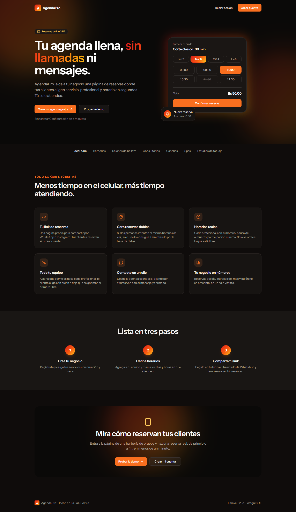
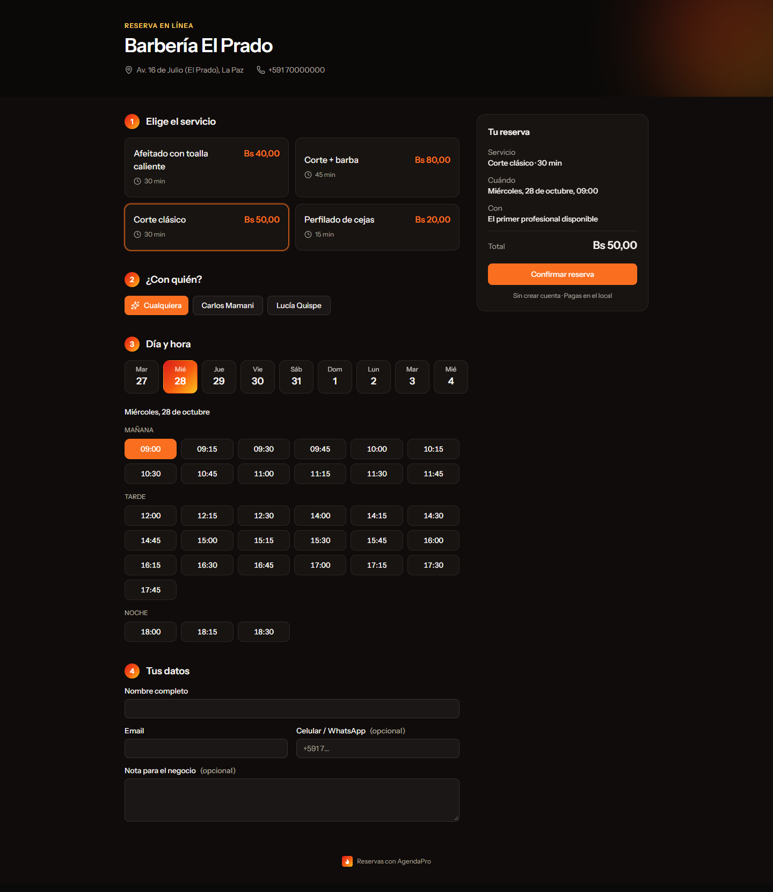
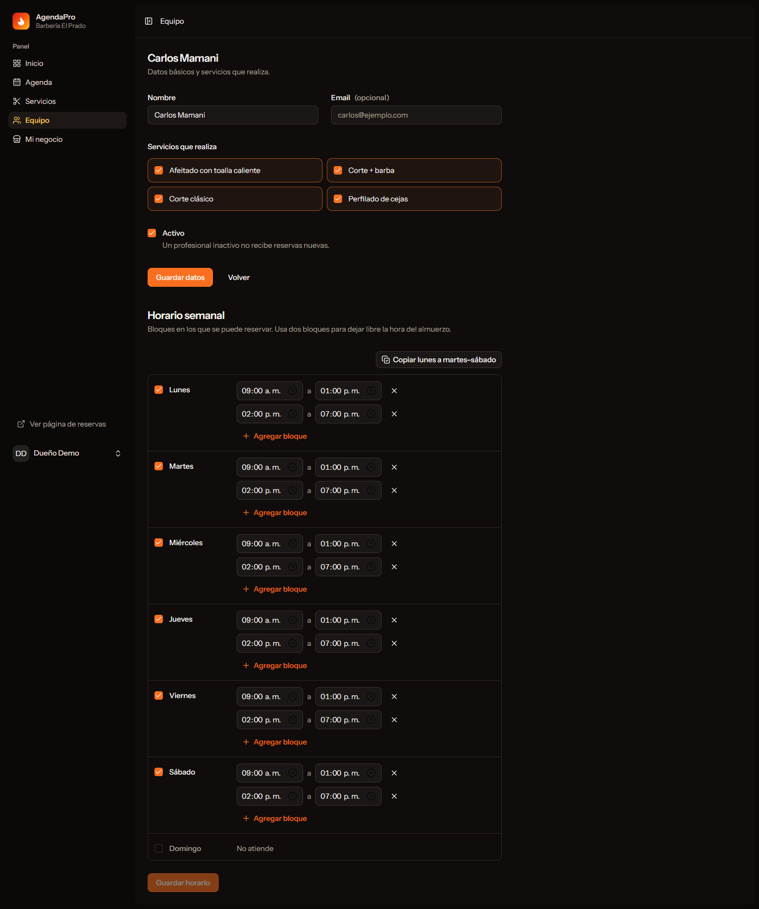
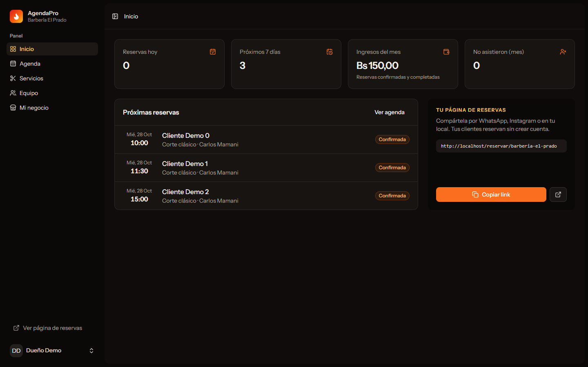
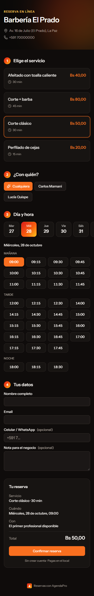

# AgendaPro

[](https://github.com/nnvaldev/agendapro/actions/workflows/ci.yml)

SaaS de reservas online para negocios de servicios —barberías, consultorios, canchas, spas— pensado para Bolivia. El negocio configura sus servicios, su equipo y sus horarios; sus clientes reservan desde un link público, sin crear cuenta, y el negocio gestiona todo desde un panel.



## Funcionalidades

**Para el cliente final**

- Página de reservas propia por negocio (`/reservar/{slug}`): elige servicio, profesional (o "cualquiera"), día y horario libre.
- Sin registro: solo nombre, email y, opcionalmente, WhatsApp.
- Link personal para ver o cancelar la reserva (`/reserva/{token}`).

**Para el negocio**

- Onboarding: al registrarse, el dueño crea su negocio y obtiene su link.
- **Servicios** con duración y precio en bolivianos, y qué profesionales los realizan.
- **Equipo** con horario semanal por profesional, varios bloques por día (pausa de almuerzo) y copia rápida del lunes al resto de la semana.
- **Agenda diaria** con filtro por profesional, contacto por WhatsApp con mensaje armado y estados: completada, no asistió, cancelada.
- **Inicio** con reservas del día, próximos 7 días, ingresos del mes y ausencias.
- Reglas de reserva configurables: intervalo de la agenda, anticipación mínima y hasta cuántos días adelante se puede reservar.
- Autenticación con verificación de email, 2FA y passkeys (Laravel Fortify).

**Correos (en cola)**

| Correo                                            | Para    | Cuándo                                                         |
| ------------------------------------------------- | ------- | -------------------------------------------------------------- |
| Reserva confirmada, con `.ics` para el calendario | Cliente | Al reservar                                                    |
| Nueva reserva                                     | Dueño   | Al reservar                                                    |
| Recordatorio                                      | Cliente | ~24 h antes, solo si reservó con más de un día de anticipación |
| Reserva cancelada por el negocio                  | Cliente | Al cancelarla desde la agenda                                  |
| El cliente canceló                                | Dueño   | Al cancelar desde su link                                      |

Los correos al cliente salen con el nombre del negocio como remitente y la respuesta va directo al dueño.

| Reserva pública                                                     | Panel: horario semanal                                           |
| ------------------------------------------------------------------- | ---------------------------------------------------------------- |
|  |  |

| Panel: inicio                                          | Móvil                                                           |
| ------------------------------------------------------ | --------------------------------------------------------------- |
|  |  |

## Stack

| Capa          | Tecnología                                                                         |
| ------------- | ---------------------------------------------------------------------------------- |
| Backend       | PHP 8.5, Laravel 13, Laravel Fortify                                               |
| Frontend      | Vue 3 + TypeScript, Inertia 3, Tailwind CSS 4, shadcn-vue (Reka UI), Wayfinder     |
| Base de datos | PostgreSQL 18                                                                      |
| Colas y caché | Redis                                                                              |
| Entorno       | Docker con Laravel Sail, Mailpit para correos en desarrollo                        |
| Calidad       | PHPUnit (92 tests), PHPStan nivel 7 (Larastan), Pint, `vue-tsc`, Vite+ lint/format |

## Decisiones técnicas

### Cero reservas dobles, garantizado por la base de datos

Validar disponibilidad en la aplicación no basta: dos peticiones simultáneas pueden pasar la validación a la vez. Por eso la tabla `bookings` tiene una **restricción de exclusión de PostgreSQL**:

```sql
EXCLUDE USING gist (
    staff_member_id WITH =,
    tstzrange(starts_at, ends_at, '[)') WITH &&
) WHERE (status IN ('pending', 'confirmed'))
```

Postgres rechaza cualquier reserva activa que se cruce con otra del mismo profesional. `BookingService` captura esa violación (`SQLSTATE 23P01`) dentro de un savepoint y, si el cliente eligió "cualquier profesional", prueba con el siguiente libre; si no queda ninguno, la API responde `409` y el frontend recarga los horarios.

### Multi-tenant con una sola base de datos

Cada servicio, profesional y reserva tiene `business_id`. El trait `BelongsToBusiness` agrega un **global scope** que filtra por el negocio activo (`CurrentBusiness`, fijado por el middleware `SetCurrentBusiness`). Ese middleware corre **antes del route model binding**, así que pedir `/servicios/{id}` de otro negocio devuelve `404`. Los tests de `tests/Feature/Panel/TenancyTest.php` cubren listados, edición, borrado, asignaciones cruzadas y cambios de estado.

### Zonas horarias

Todo se guarda en UTC (`timestamptz`) y se calcula en la zona del negocio (`America/La_Paz` por defecto). Los horarios de atención son horas locales y la API devuelve ISO 8601 con offset (`2026-11-03T09:00:00-04:00`), para que el frontend muestre la hora del negocio sin depender de la zona del navegador.

### Cálculo de disponibilidad

`AvailabilityService` genera los horarios de un día por profesional: recorre cada bloque de atención cada `slot_interval_minutes`, exige que el servicio completo entre en el bloque y descarta los horarios dentro de la anticipación mínima, fuera de la ventana de reserva o que se crucen con reservas activas o bloqueos de agenda. Horarios, reservas y bloqueos de todos los profesionales se cargan con eager loading, así que la cantidad de consultas no crece con el tamaño del equipo (sin N+1).

### Correos en cola sin romper la reserva

Las notificaciones implementan `ShouldQueue` y se encolan con `afterCommit()`, así que nunca se envía un correo de una reserva que terminó revirtiéndose. `BookingNotifier` decide quién recibe qué; si encolar falla (por ejemplo, Redis caído), el error se reporta pero la reserva igual se confirma. El recordatorio lo envía `bookings:send-reminders` cada 15 minutos desde el Scheduler, y marca `reminder_sent_at` antes de encolar para no duplicar.

### Otros detalles

- El **precio se congela** en la reserva: si el servicio cambia de precio, el historial no se altera.
- El token para gestionar la reserva es un **UUID v4 aleatorio** (no v7), para que no revele cuándo se creó.
- Las reservas canceladas no se pueden reactivar: su horario pudo haberlo tomado otra persona.
- Servicios y profesionales con reservas no se borran; se desactivan.

## Puesta en marcha

Requisitos: Docker Desktop y Node.js 22+. No hace falta PHP en la máquina: corre dentro del contenedor de Sail.

```bash
git clone https://github.com/nnvaldev/agendapro.git
cd agendapro
cp .env.example .env

# Dependencias PHP (con un contenedor temporal de Composer)
docker run --rm -v "$(pwd):/app" -w /app laravelsail/php84-composer:latest composer install

# Levantar PostgreSQL, Redis, Mailpit y la app
docker compose up -d
docker compose exec -u sail laravel.test php artisan key:generate
docker compose exec -u sail laravel.test php artisan migrate --seed

# Frontend
npm install
npm run dev
```

La app queda en http://localhost y los correos de prueba en http://localhost:8025.

`docker compose up -d` levanta 6 servicios: la app, PostgreSQL, Redis, Mailpit, el worker de colas (`queue`) y el Scheduler (`scheduler`). El worker no recarga código solo: después de cambiar correos o jobs, usa `docker compose restart queue`.

> **Windows:** usa siempre `-u sail` al ejecutar comandos en el contenedor. Si se ejecutan como `root`, quedan archivos en `storage/` que la app no puede escribir. Si no tienes PHP en tu máquina, descomenta `WAYFINDER_COMMAND` en tu `.env` para que Vite genere las rutas tipadas de Wayfinder dentro del contenedor.

### Cuentas de demo

| Rol                          | Email                 | Contraseña |
| ---------------------------- | --------------------- | ---------- |
| Dueño de "Barbería El Prado" | `demo@agendapro.test` | `password` |

Página pública de la demo: http://localhost/reservar/barberia-el-prado

## Producción con Docker

La imagen de producción (`Dockerfile`) usa **FrankenPHP**: PHP 8.5 con Caddy integrado, que obtiene y renueva el certificado HTTPS de Let's Encrypt automáticamente.

- **Build multi-stage:** Composer sin dependencias de desarrollo y frontend compilado con Vite sobre Debian; la imagen final corre sobre **Alpine** (514 MB frente a 1,08 GB con Debian).
- **Seguridad:** el proceso corre sin root (`setcap` para abrir los puertos 80/443), PHP no expone su versión y OPcache no revalida archivos.
- **Arranque:** el entrypoint cachea configuración, rutas, vistas y eventos con las variables reales del servidor.
- **Healthcheck:** contra `/up`.

`compose.prod.yaml` levanta la app, el worker de colas, el Scheduler, PostgreSQL y Redis. Solo la app publica puertos; la base de datos y Redis quedan en una red interna.

```bash
cp .env.production.example .env.production   # completar dominio, APP_KEY, clave de BD y SMTP
docker compose -f compose.prod.yaml --env-file .env.production up -d --build
docker compose -f compose.prod.yaml --env-file .env.production run --rm app php artisan migrate --force

# Opcional: negocio de demo (sin Faker, apto para producción)
docker compose -f compose.prod.yaml --env-file .env.production run --rm app php artisan db:seed --class=DemoBusinessSeeder --force
```

Para probarlo en local junto a Sail, usa otro nombre de proyecto (`-p agendapro-prod`), `SERVER_NAME=:80` y `HTTP_PORT=8080`.

## API pública

La usa la página de reservas y no requiere autenticación.

| Método | Ruta                                                                     | Descripción                                                                       |
| ------ | ------------------------------------------------------------------------ | --------------------------------------------------------------------------------- |
| `GET`  | `/api/businesses/{slug}`                                                 | Perfil, servicios y profesionales activos                                         |
| `GET`  | `/api/businesses/{slug}/availability?service_id=&date=&staff_member_id=` | Horarios libres de un día                                                         |
| `POST` | `/api/businesses/{slug}/bookings`                                        | Crear reserva (`201`, `409` si el horario se ocupó, `422` si hay datos inválidos) |
| `GET`  | `/api/bookings/{token}`                                                  | Ver una reserva                                                                   |
| `POST` | `/api/bookings/{token}/cancel`                                           | Cancelar una reserva                                                              |

Crear y cancelar tienen un límite de 10 peticiones por minuto.

## Tests y calidad

```bash
docker compose exec -u sail laravel.test php artisan test        # 92 tests
docker compose exec -u sail laravel.test ./vendor/bin/phpstan    # análisis estático nivel 7
docker compose exec -u sail laravel.test ./vendor/bin/pint --test
npx vue-tsc --noEmit                                             # tipos del frontend
npx vp check                                                     # lint y formato
```

Los tests corren contra PostgreSQL real (base `testing` de Sail), así que la restricción de exclusión y las zonas horarias se prueban de verdad.

### Integración continua

Cada push a `main` y cada pull request ejecutan [`.github/workflows/ci.yml`](.github/workflows/ci.yml) con tres jobs en paralelo:

- **Calidad:** Pint, PHPStan, lint y formato del frontend y `vue-tsc`.
- **Tests:** PHP 8.5 contra un servicio de PostgreSQL 18, con build del frontend para las páginas Inertia.
- **Terraform:** formato, `validate` y `terraform test` de la infraestructura.

Las acciones están fijadas por SHA y Dependabot propone cada semana actualizaciones de Actions, Composer y npm.

## Infraestructura (Oracle Cloud Always Free)

`infra/terraform/` define todo el servidor como código, dentro del plan gratuito de Oracle Cloud:

| Recurso  | Detalle                                                                                                                                   |
| -------- | ----------------------------------------------------------------------------------------------------------------------------------------- |
| Red      | VCN, internet gateway y subnet pública                                                                                                    |
| Firewall | SSH solo desde la IP del administrador; HTTP, HTTPS y HTTP/3 abiertos                                                                     |
| Servidor | VM ARM Ampere A1 (2 OCPU, 12 GB por defecto; hasta 4/24 gratis) con Ubuntu 24.04                                                          |
| Arranque | cloud-init instala Docker, rotación de logs, fail2ban y abre 80/443 en iptables (las imágenes de Ubuntu en OCI vienen cerradas salvo SSH) |
| Costos   | Presupuesto con alerta por email ante el primer gasto real                                                                                |

Las variables validan los límites de Always Free: pedir más de 4 OCPU, 24 GB o 200 GB de disco falla antes de tocar la nube.

**Tests sin cuenta de Oracle.** `tests/always_free.tftest.hcl` usa un `mock_provider`, así que `terraform test` ejecuta un plan completo en local y en CI, y verifica que la VM esté dentro del plan gratuito, que SSH solo acepte `admin_cidr`, que la web esté abierta y que la alerta de presupuesto exista.

```bash
cd infra/terraform
docker run --rm -v "$(pwd):/tf" -w /tf hashicorp/terraform:1.17.0 init -backend=false
docker run --rm -v "$(pwd):/tf" -w /tf hashicorp/terraform:1.17.0 test
```

### Crear el servidor

1. Crea la cuenta en Oracle Cloud y elige como región home **São Paulo** o **Santiago**, las más cercanas a Bolivia.
2. En la consola: **Perfil → Mi perfil → Claves API → Agregar clave API**. Descarga la clave privada y copia los datos que muestra (tenancy, user, fingerprint, región).
3. `cp terraform.tfvars.example terraform.tfvars` y completa esos datos, tu clave SSH pública, tu IP y tu email.
4. `terraform init` y `terraform apply`. Al terminar muestra la IP pública y el comando SSH.
5. Si responde _Out of host capacity_, cambia `availability_domain_index` o baja a 1 OCPU / 6 GB y vuelve a intentar: la capacidad ARM gratuita se libera a lo largo del día.

> Oracle puede recuperar VMs Always Free que pasan semanas casi sin uso. Una app con tráfico y un monitor de uptime cada pocos minutos lo evitan.

## Deploy automático

`.github/workflows/deploy.yml` se ejecuta **solo cuando el CI pasa en `main`** (o a mano desde Actions):

1. **Imagen:** build para ARM64 en un runner ARM nativo de GitHub, sin emulación, y push a GitHub Container Registry con el tag del commit y `latest`.
2. **Servidor:** por SSH copia `compose.prod.yaml` y los scripts, y escribe `.env.production` desde un secreto con permisos `600`.
3. **`docker/deploy.sh`:** baja la imagen, corre las migraciones, levanta app, worker y Scheduler, y **espera a que los healthchecks pasen**. Si la versión nueva no queda sana, **vuelve sola a la anterior** y el job falla.

El token del registry viaja por stdin y se cierra sesión al terminar. La imagen en producción queda en `.env.deployed`, así los comandos manuales en el servidor usan la versión que corre de verdad.

**Backups:** `deploy.sh` programa `docker/backup.sh` en cron (04:15 UTC). Hace un `pg_dump` en formato custom y conserva 14 días en `/opt/agendapro/backups`.

### Configurar el deploy (una vez)

En GitHub: **Settings → Environments → New environment** `production`, y dentro:

| Tipo              | Nombre               | Valor                                                                  |
| ----------------- | -------------------- | ---------------------------------------------------------------------- |
| Secret            | `DEPLOY_HOST`        | IP pública (salida `public_ip` de Terraform)                           |
| Secret            | `DEPLOY_SSH_KEY`     | Clave **privada** SSH cuya pública pusiste en `terraform.tfvars`       |
| Secret            | `ENV_PRODUCTION`     | Contenido completo de tu `.env.production`                             |
| Secret (opcional) | `DEPLOY_KNOWN_HOSTS` | Salida de `ssh-keyscan <IP>`, para verificar la identidad del servidor |
| Variable          | `APP_URL`            | `https://tu-dominio`, para el link del deploy                          |

Si el repositorio es privado, los runners ARM no son gratuitos: crea la variable `BUILD_RUNNER=ubuntu-latest` y la imagen se compila con emulación QEMU.

### Comandos en el servidor

```bash
cd /opt/agendapro
alias dc='docker compose -f compose.prod.yaml --env-file .env.production --env-file .env.deployed'

dc ps                                     # estado y healthchecks
dc logs -f app                            # logs en vivo
dc run --rm app php artisan db:seed --class=DemoBusinessSeeder --force   # negocio de demo
./backup.sh                               # backup manual
```

## Estructura

```
app/
├── Enums/BookingStatus.php          estados y transiciones permitidas
├── Http/Controllers/
│   ├── Api/                         API pública de reservas
│   ├── Panel/                       panel del negocio (Inertia)
│   └── PublicBookingController.php  páginas públicas
├── Models/Concerns/BelongsToBusiness.php   aislamiento por negocio
├── Services/
│   ├── AvailabilityService.php      cálculo de horarios libres
│   └── BookingService.php           creación de reservas sin choques
└── Tenancy/CurrentBusiness.php
resources/js/
├── pages/                           Dashboard, agenda, services, staff, business, public, onboarding
├── components/WeeklyScheduleEditor.vue
└── lib/format.ts                    moneda, fechas y horas para Bolivia
tests/Feature/
├── Booking/                         disponibilidad y API
└── Panel/                           onboarding, aislamiento, servicios, horarios, agenda
```

## Próximos pasos

- [x] Confirmación, recordatorio y avisos de cancelación por email con colas y Scheduler.
- [ ] Agenda en tiempo real con Laravel Reverb (WebSockets).
- [ ] Pago de seña con pasarela intercambiable (driver de prueba y QR).
- [ ] Bloqueos de agenda (vacaciones, trámites) desde el panel. El backend ya los soporta.
- [ ] Reprogramar una reserva desde el link del cliente.
- [x] CI con GitHub Actions.
- [x] Imagen de producción con FrankenPHP y Docker Compose.
- [x] Infraestructura en Oracle Cloud con Terraform y tests sin cuenta.
- [x] Deploy automático con rollback y backups diarios.
- [ ] Demo en vivo en Oracle Cloud.

---

Desarrollado por **Alexander Castillo** ([@nnvaldev](https://github.com/nnvaldev)) · La Paz, Bolivia.
